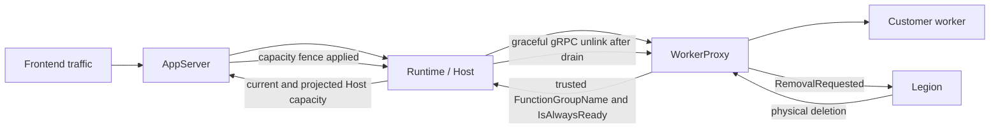
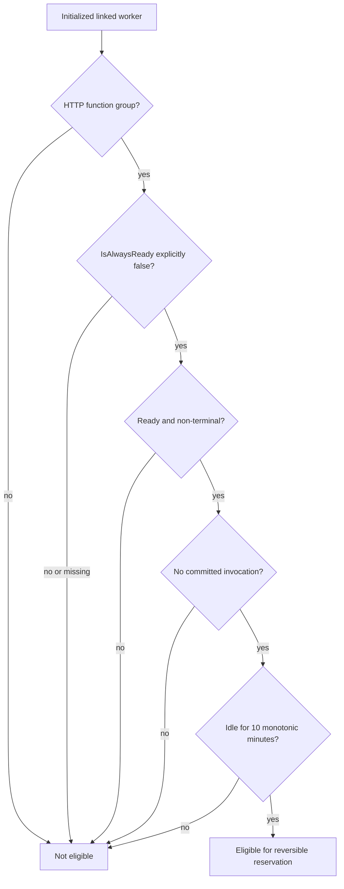
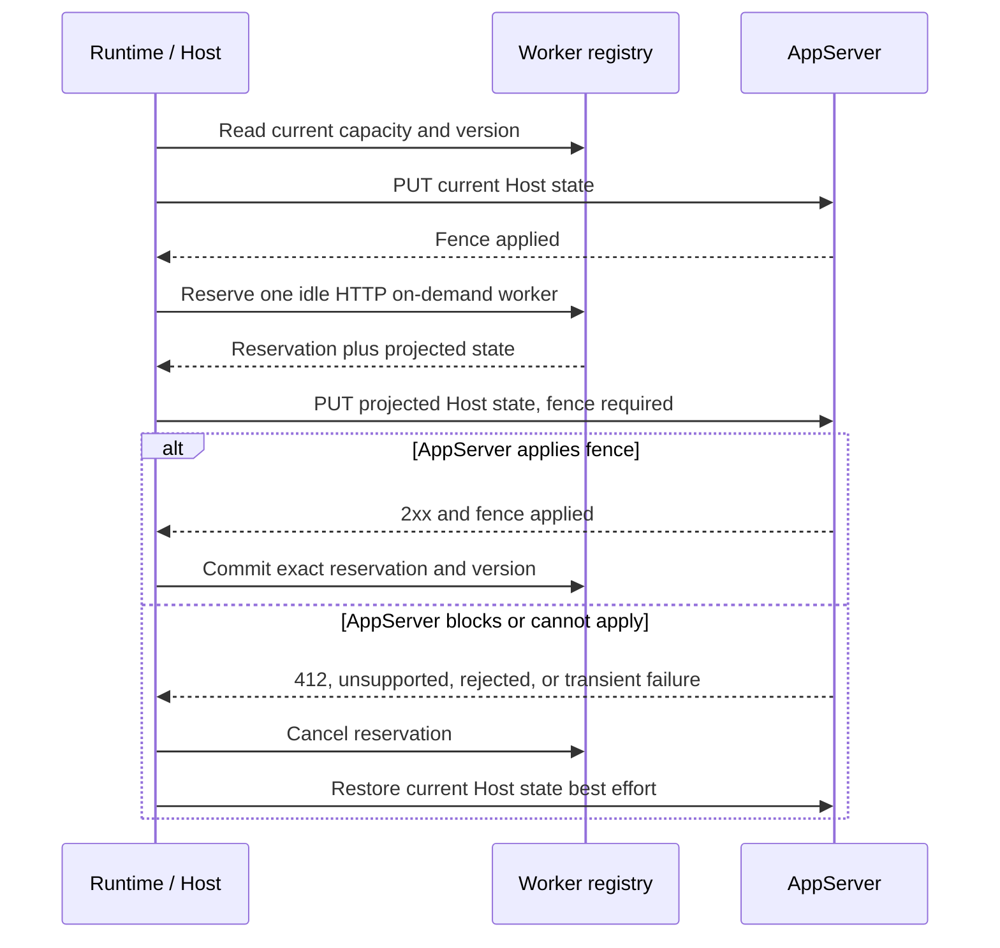
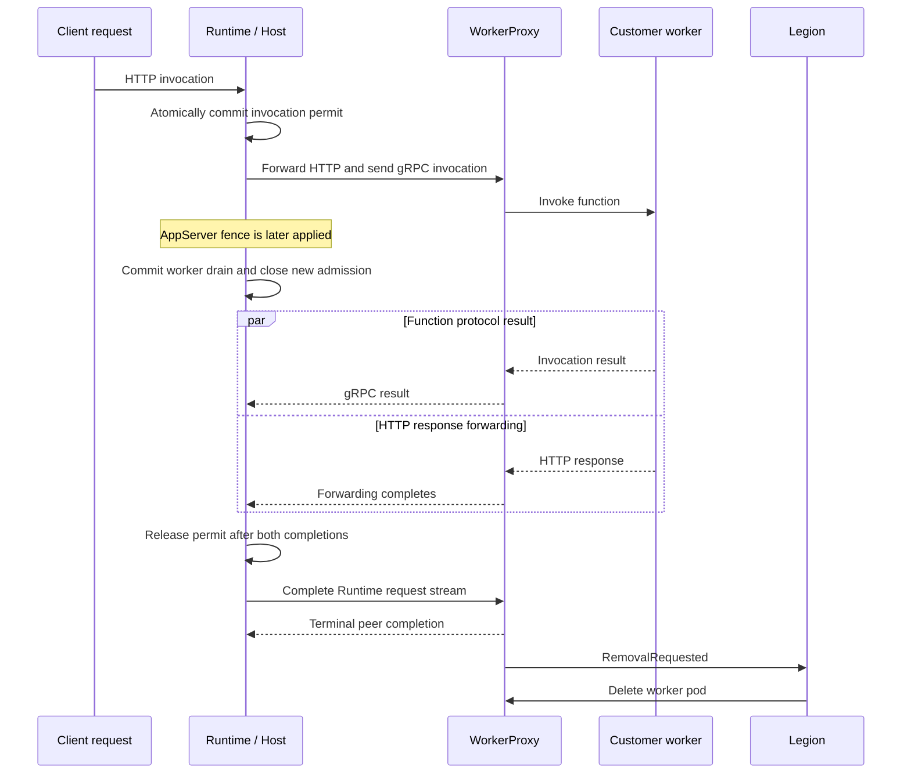
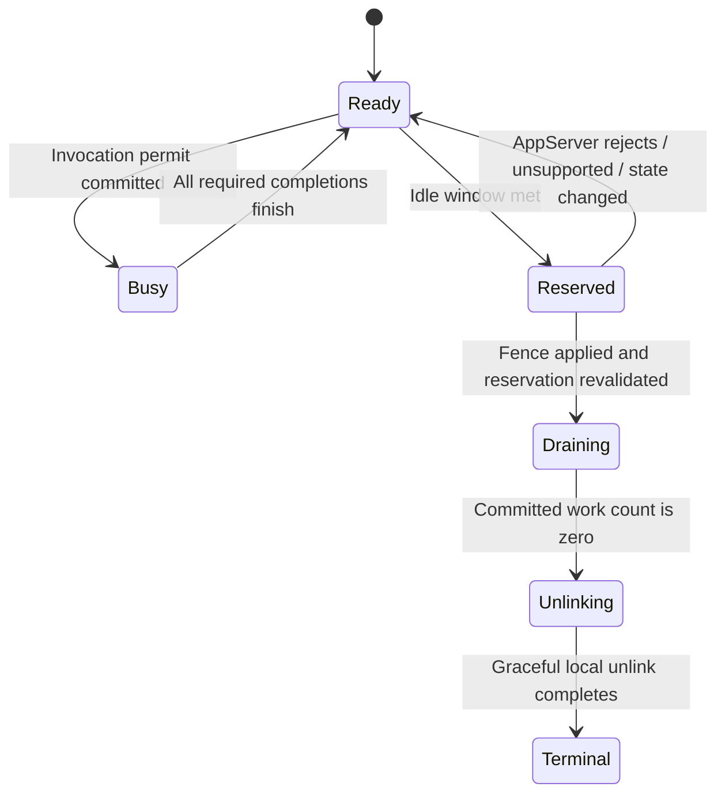
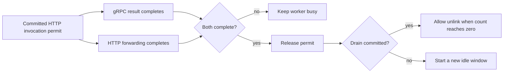

# HTTP on-demand worker scale-in

This guide explains the changes that let the Runtime drain an idle BYOC HTTP worker without interrupting an invocation. It is written as the primary review path for the PR: start here, then use the code for implementation details.

## Problem

An on-demand worker can stay linked after its traffic has stopped. Before this change, the Runtime had no safe way to reduce that linked capacity:

- Removing a worker while an invocation was starting could interrupt customer work.
- Removing capacity without AppServer agreement could violate Frontend request-slot obligations.
- The Runtime could not trust a customer-provided capability to decide whether a worker was on-demand.
- Completing a gRPC invocation result was not enough for proxied HTTP because response forwarding could still be active.

The change adds a two-phase scale-in flow:

1. **R2: reserve and fence capacity.** The Runtime reversibly reserves one eligible idle worker, then asks AppServer to accept the projected lower capacity.
2. **W4: drain and unlink.** Only after AppServer confirms the capacity fence does the Runtime close new admission, wait for already committed work, and unlink the worker.

Legion still owns physical pod deletion.

## Before and after

### Before

The Runtime could link and explicitly unlink a worker, but it did not have an autonomous, capacity-aware idle scale-in path.

### After

The Runtime can now remove one eligible idle worker from admission, but it cannot commit the drain until AppServer accepts the projected capacity.

## Ownership boundaries

| Component | Owns | Does not own |
| --- | --- | --- |
| **WorkerProxy** | Replaces worker-supplied classification with the platform assignment's `FunctionGroupName` and `IsAlwaysReady` values. Reports terminal peer closure through its existing removal state. | Idle timing, capacity calculation, invocation admission, or pod deletion. |
| **Runtime / Host** | Tracks linked capacity, continuous idle time, reversible reservations, invocation permits, AppServer publication, drain commitment, and local unlink. | Frontend slot policy or physical deletion. |
| **AppServer** | Accepts or rejects the projected Host capacity using the Host-state transaction and capacity-fence acknowledgement. | Selecting a specific worker or draining its invocations. |
| **Legion** | Observes WorkerProxy removal state and performs physical pod deletion. | Runtime-local invocation admission or AppServer capacity fencing. |
| **Customer worker container** | Executes functions and completes the existing worker protocol. | Receiving a new per-worker drain command. |

This separation is important because no single component has enough information to make the entire decision safely.

## Eligibility

A worker is considered for autonomous scale-in only when all of the following remain true:

- WorkerProxy classified it as the HTTP function group.
- WorkerProxy explicitly set `IsAlwaysReady` to `false`.
- The channel completed setup for the active ScriptHost.
- The channel is not reserved, draining, terminal, or handling committed work.
- It has remained continuously idle for ten minutes according to a monotonic clock.

Missing or invalid classification is not treated as on-demand. That makes mixed versions fail closed.

## End-to-end R2 and W4 flow

### R2: reversible reservation and capacity fence

R2 is the reversible part of the operation.

1. The Host publishes its current linked-worker count and usable HTTP capacity.
2. It waits until that publication is stable with respect to the Host-local state version.
3. It reserves one eligible idle worker under the same lock used for invocation admission.
4. Reservation immediately removes the worker from ready-channel selection and usable HTTP capacity.
5. The Host publishes the projected state to AppServer with `x-ms-functions-host-state-capacity-fence: required`.
6. AppServer must return success with `x-ms-functions-host-state-capacity-fence: applied`.
7. Any unsupported, blocked, rejected, transient, canceled, or stale result cancels the reservation and republishes current capacity best effort.
8. A successful acknowledgement allows the Host to revalidate the exact reservation and projected state version before committing W4.

The reservation is intentionally reversible. It prevents new dispatch to the selected worker while AppServer decides, but it does not start the irreversible drain.

### W4: committed drain and unlink

W4 starts only after the AppServer fence is acknowledged and the reservation still matches the current Host state.

1. The channel converts the reservation into an irreversible drain.
2. New invocation admission remains closed.
3. Invocations committed before the reservation keep their permits and complete normally.
4. For proxied HTTP, the permit is released only after both the gRPC invocation result and HTTP forwarding finish, regardless of completion order.
5. When committed work reaches zero, the registry calls the existing graceful `UnlinkAsync`.
6. Runtime completes its request stream and waits up to ten seconds for peer termination.
7. WorkerProxy observes the terminal Runtime attachment and publishes its existing removal request.
8. Legion performs physical deletion.

## Invocation admission and completion

The same channel lock protects reservation and invocation admission. This gives a clear outcome to a race:

- If invocation admission wins, the invocation is committed and the worker cannot be reserved until that work completes.
- If reservation wins, the worker is removed from ready selection and the dispatcher retries another ready channel.
- After drain commitment, no new invocation can be admitted to that worker.

For ordinary gRPC work, one result completion releases the permit. For proxied HTTP work, the permit has two completion signals:

This prevents a result-first or forwarding-first ordering from making the worker look idle too early.

## Capacity model

The Host-state payload contains:

- `createdTime`: a strictly increasing UTC value for the Host-state transaction.
- `linkedWorkerCount`: all initialized, non-terminal linked workers.
- `httpCapacity`: usable eligible HTTP capacity.

The current implementation contributes 16 HTTP request slots per eligible worker. A reserved or draining worker contributes zero usable capacity, although it remains linked until its committed work completes.

The reservation stores the projected capacity, linked count, and Host-local state version. Commit fails if any of them changed. The service then cancels or abandons the stale reservation and republishes current state.

## Failure and rollout behavior

The feature is fail closed:

| Condition | Behavior |
| --- | --- |
| WorkerProxy does not provide both trusted classification capabilities | Worker is not eligible. |
| `IsAlwaysReady` is missing, invalid, or `true` | Worker is not eligible. |
| Old AppServer returns success without the fence acknowledgement | Reservation is canceled and capacity is restored. |
| AppServer returns `412 Precondition Failed` | Worker is retained because projected capacity does not cover Frontend obligations. |
| AppServer rejects, is unauthorized, is unavailable, or times out | Reservation is canceled and the pass stops. |
| Host state changes before commit | Exact reservation revalidation fails; the worker is not drained by that stale decision. |
| Runtime or channel terminates | Pending committed invocations receive the existing shutdown failure path and local cleanup continues. |
| Drain or unlink cannot complete locally | The drain completion reports failure; no forced customer-process termination is added. |

Mixed-version rollout is safe because both trusted WorkerProxy classification and the AppServer fence acknowledgement are required before the Runtime commits a drain.

## Assumptions

These are product assumptions accepted for this PR. They are not presented as pre-existing platform requirements.

- Autonomous scale-in applies only to HTTP on-demand workers.
- WorkerProxy is the trusted source of `FunctionGroupName` and `IsAlwaysReady`; customer-supplied values are discarded.
- `IsAlwaysReady` must be explicitly `false`. Missing classification is not inferred.
- The R2 eligibility window is ten minutes of monotonic idle time and resets when an invocation is committed.
- The current capacity calculation assumes 16 usable HTTP request slots per eligible worker.
- The current AppServer grant-safe capacity-fence predicate and fixed capacity are accepted for this PR; dynamic or per-worker concurrency is not included.
- AppServer implements the companion Host-state capacity-fence contract and returns the acknowledgement header only after it has protected Frontend slot obligations.
- The Runtime and AppServer compare one projected Host snapshot at a time; the Host-local version prevents committing a stale reservation.
- Legion continues to observe WorkerProxy removal state and owns deletion after Runtime unlink.

## Known limitations

- Non-HTTP workers are not autonomously scaled in.
- W4 is intentionally HTTP-only in this PR; non-HTTP drain belongs to the later P1 work.
- The Runtime does not send a new per-worker drain command to the customer container.
- There is no forced cancellation, migration, or replay of an invocation.
- There is no fixed timeout for waiting on already committed work to drain.
- Physical deletion remains Legion-owned and is not proven by local unlink success.
- Capacity is currently fixed at 16 slots per eligible HTTP worker.
- Mixed versions retain workers when either trusted classification or the AppServer fence contract is unavailable.
- A process that cannot report removal still depends on existing Legion recovery.
- Runtime `OutstandingWorkerRemovals` fallback is required follow-up work and is not implemented by this PR.
- The change does not add transport authentication, a network-loss detector, or deployment automation.

## Code map

| Area | Main responsibility |
| --- | --- |
| `Functions.WorkerProxy/Rpc/FunctionRpcRelay.Session.cs` | Replaces worker-supplied classification with trusted assignment values. |
| `Functions.Rpc.Client/WorkerChannel/RpcClientWorkerChannel.cs` | Atomic invocation admission, idle timing, reservation, commit, and HTTP dual-completion permits. |
| `Functions.Rpc.Client/Registry/WorkerChannelRegistry.cs` | Capacity snapshots, exact reservation revalidation, drain completion, and graceful unlink. |
| `Functions.Rpc.Client/ScaleIn/IHttpWorkerScaleInManager.cs` | Cross-assembly Host-local scale-in contract and immutable snapshots. |
| `Functions.Host/HostState/AppServerHostStateClient.cs` | Host-state publication and capacity-fence result classification. |
| `Functions.Host/HostState/HttpOnDemandWorkerScaleInService.cs` | Periodic R2 selection, AppServer fencing, rollback, and W4 commitment. |
| `WebJobs.Script.Grpc/Channel/WorkerChannel.cs` | Invocation send hooks that keep HTTP forwarding inside the permit lifetime. |

## Behavioral test matrix

The PR adds four behavior-level test methods, with six executed cases:

| Test | Cases | Proves |
| --- | ---: | --- |
| `RunScaleInPassAsync_AppServerDoesNotApplyProjectedCapacity_RestoresInvocationAdmission` | 2 | Unsupported success and explicit rejection both cancel the reservation, republish current capacity, and allow a real invocation through the dispatcher. |
| `TryReserveIdleWorker_InvocationCommittedFirst_CompletesWithoutInterruption` | 1 | An invocation committed before reservation remains protected, completes normally, and only then makes the worker reservable. |
| `InvokeAsync_HttpDrainWaitsForResultAndForwarding` | 2 | Result-first and forwarding-first HTTP completion both keep the worker busy until both signals finish. |
| `TryCommitReservation_RevalidatesStateAndUnlinksIdleWorkerExactlyOnce` | 1 | A stale reservation cannot commit after the state version changes, even when capacity and linked-worker count return to the projected values; a fresh empty drain unlinks once. |

These are in-memory behavioral tests through the hosted scale-in service, dispatcher, registry, real client worker channel, and protocol transport. They are not deployed Legion or AppServer end-to-end validation.
