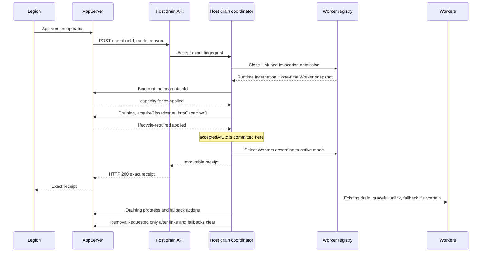
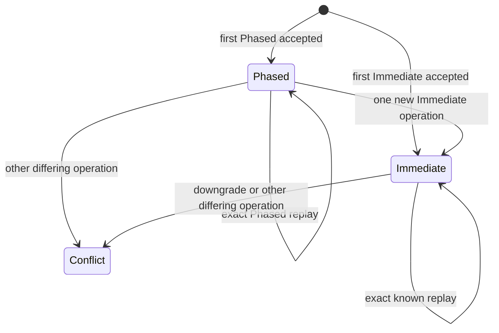
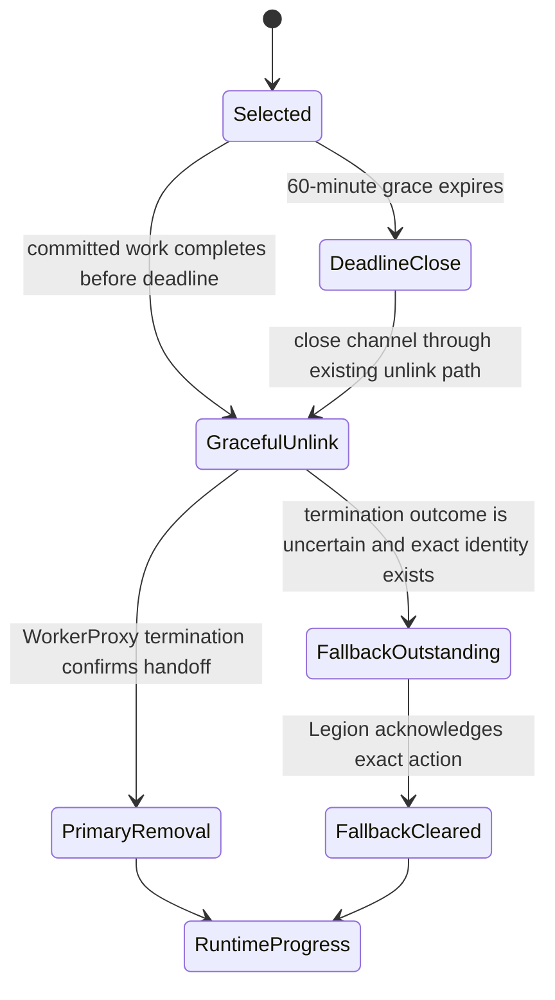

# BYOC app-version Runtime drain reviewer guide

> **Scope:** Functions Host and WorkerProxy-side lifecycle reuse for P2 Phased reconciliation and
> P3 Immediate stop/delete/restart handling.
> **Public API:** authenticated `POST /admin/functions/drain`.
> **Stack:** built directly on the existing R2 drain path, exact worker-removal fallback, R4 Runtime
> retirement fence, and P1 count-only Worker scale-in.

## 1. Context and non-goals

Legion owns app-version detection, durable operation state, Runtime-set capture, Recreate versus
RollingUpdate policy, and discovery behavior. AppServer relays one authenticated request to Host.
Host owns only the local Runtime admission fence, Worker scheduling, invocation grace, graceful
unlink, fallback handoff, and final Runtime `RemovalRequested`.

This change does not add:

- Legion reconciliation or durable operation state;
- AppServer retry or a Go-to-Host callback beyond the coordinated relay;
- a second Worker removal path;
- forced cancellation before a Worker's committed-invocation grace deadline;
- generalized operation history or Immediate-to-Phased downgrade;
- Host-process schedule recovery.

## 2. Shared contract

The request requires three known fields. Additive unknown fields are accepted for forward
compatibility. Missing known fields, wrong JSON types, case-variant known field names, duplicate
properties, malformed JSON, invalid values, and a zero operation ID return HTTP `400`.

```http
POST /admin/functions/drain
Content-Type: application/json

{
  "operationId": "47bf3a08-900a-48b3-a0f1-f6baa87191f0",
  "mode": "Phased",
  "reason": "ConfigurationChange"
}
```

| Field | Accepted values |
| --- | --- |
| `operationId` | Required nonzero GUID. |
| `mode` | `Phased` or `Immediate`. |
| `reason` | `ConfigurationChange`, `Stop`, `Delete`, or `Restart`. |

The success response is HTTP `200` and contains exactly three fields:

```json
{
  "operationId": "47bf3a08-900a-48b3-a0f1-f6baa87191f0",
  "mode": "Phased",
  "acceptedAtUtc": "2026-10-30T00:00:00+00:00"
}
```

`acceptedAtUtc` is the Host-authoritative RFC 3339 acceptance time. The operation ID and mode match
the request. Scheduling details, reason, batch size, deadlines, Worker IDs, and Runtime incarnation
remain private Host state.

| Result | HTTP behavior |
| --- | --- |
| First valid operation | `200` only after local Link/invocation admission is closed and AppServer acknowledges `lifecycle-required`. |
| Exact operation ID and payload replay | Original immutable receipt; snapshots and deadlines are not reset. |
| Same operation ID with different payload | `409`. |
| Different operation while Phased is active | `409`, except for the one allowed Immediate escalation. |
| Different operation after Immediate is active | `409`. |
| Invalid mode, reason, required field, body, duplicate property, or zero GUID | `400`. |
| AppServer admission fence cannot be committed | Non-success response with no receipt. |

The coordinated Go relay at commit `7350d9e1e6273810569d1320df140576c3098804`
forwards the request once, preserves Host non-success status/body/content type, and treats an invalid
or unexpected Host `200` as `502`. Host therefore owns all replay, conflict, and escalation behavior.

## 3. Shared admission and retirement sequence



Closing admission and taking the initial snapshot occur under the registry state lock. Each channel
classifies its pre-closure invocation readiness under the same channel lock used by invocation
admission, then permanently closes Runtime admission. A concurrent P1 or R2 drain either commits
first and is tracked as pre-existing work, or observes Runtime retirement and cannot create a later
selection.

## 4. P2 Phased scheduling

The initial non-HTTP snapshot contains linked, invocation-ready Workers that were not already
draining. It includes on-demand and always-ready classes. HTTP Workers are kept in a separate
snapshot. Worker IDs are sorted ordinally for deterministic selection. Linked Workers that are not
invocation-ready are excluded from `N` and both timed snapshots, but receive immediate drain
ownership after the lifecycle fence. Because Runtime admission is already closed, they cannot gain
new committed invocations and cannot strand final Runtime removal.

For `N` initial non-HTTP Workers:

```text
batchSize = max(1, ceil(N * 20%))
```



```mermaid
gantt
    title Phased Worker selection from Host acceptance
    dateFormat X
    axisFormat %Ss
    section Non-HTTP
    Batch 1 :milestone, 0, 0
    Batch 2 :milestone, 10, 0
    Batch 3 :milestone, 20, 0
    Batch 4 :milestone, 30, 0
    Batch 5 :milestone, 40, 0
    section HTTP
    All initial HTTP Workers :milestone, 35, 0
```

Each selected Worker receives an immutable 60-minute deadline from its own actual selection time.
The deadline bounds committed-invocation grace, not AppServer acknowledgement latency. Workers
already draining through R2 or P1 retain their existing drain and remain part of Runtime completion;
P2 does not replace or reset that work.

Exact replay returns the original receipt and does not recreate the snapshot, restart the 0/10/20/
30/35/40-second schedule, or move any Worker deadline.

## 5. P3 Immediate and escalation

A first `Immediate` request uses the same admission closure and AppServer lifecycle fence. After
fence acknowledgement, Host selects every remaining linked, invocation-ready Worker immediately
across HTTP, non-HTTP, on-demand, and always-ready classes. Each new selection receives a
60-minute deadline from Immediate acceptance. Any linked Worker that was not invocation-ready at
admission closure is also terminally owned immediately without changing the ready-Worker selection
set or deadline policy.

`Stop`, `Delete`, and `Restart` have identical Host scheduling semantics. The reason remains part of
the exact operation fingerprint and structured diagnostics; Legion owns its external meaning.



During the one allowed Phased-to-Immediate escalation:

1. Host retains the original Phased receipt for exact replay.
2. Host cancels or neutralizes future Phased timer selections.
3. Already-selected Workers keep their original P2 deadlines.
4. Every remaining eligible Worker is selected once with an escalation-time deadline.
5. Host returns and retains the new Immediate receipt.
6. Phased cannot resume and another differing operation returns `409`.

The coordinator retains at most the initial operation and one escalation. It is not a generalized
operation-history or workflow framework.

## 6. Deadline, unlink, and fallback behavior



At deadline, Host stops waiting for committed invocation completion and calls the existing unlink
path. That path fails remaining local invocation permits, completes the FunctionRpc request stream,
waits for WorkerProxy termination, disposes the channel, and records the existing exact
`RuntimeUnlink` fallback action when primary handoff is uncertain. No second removal command or
identity scheme is introduced.

Pre-existing R2/P1 drain tasks and newly selected drain tasks must all complete successfully. Final
Runtime `RemovalRequested` additionally requires:

- no linked Worker channel remains;
- no exact fallback action remains outstanding;
- the current selection schedule is final for the active mode.

A timer alone cannot bypass fallback ownership.

## 7. Ownership

| Component | Owns | Does not own |
| --- | --- | --- |
| Legion | Action detection, Runtime-set capture, durable operation state, Recreate/RollingUpdate policy, discovery, and physical deletion. | Host-local Worker scheduling or invocation admission. |
| Go AppServer relay | Authenticated one-shot relay, Host response preservation, and invalid-`200` rejection. | Retry, replay, conflict, escalation, or Worker selection. |
| Host controller/coordinator | Strict request validation, exact fingerprint, one optional escalation, receipt, fence ordering, schedule, progress, and final Runtime lifecycle. | Durable recovery or external app-version policy. |
| Worker registry/channel | Atomic admission closure, deterministic eligibility, existing-drain tracking, invocation grace, unlink, and fallback creation. | AppServer lifecycle acknowledgement or physical deletion. |
| WorkerProxy | Existing sticky primary Worker `RemovalRequested`. | P2/P3 scheduling or Runtime finalization. |

## 8. Compatibility and failure direction

- R2 and P1 stop creating new selections after Runtime retirement closes admission.
- A committed R2/P1 drain remains tracked and can still produce the existing exact fallback action.
- R4 duplicate activation-fault retirement remains idempotent for R4-owned retirement. R4 cannot
  replace an active app-version schedule with an uncoordinated second retirement flow.
- Older Link callers without exact identity keep primary WorkerProxy removal, but an uncertain
  unlink cannot complete Runtime retirement without durable fallback ownership.
- AppServer lifecycle publication remains serialized through the existing Host-state client gate.
- Any bind, lifecycle fence, progress, or final-removal publication failure leaves the Runtime
  locally closed and does not create a success-shaped response or completion.
- A failed lifecycle task is latched. A later Phased-to-Immediate escalation is rejected instead of
  returning a receipt for a schedule that no longer has a finalization owner.

## 9. Assumptions and known limitations

- AppServer uses the coordinated one-shot relay and exact contract from
  `7350d9e1e6273810569d1320df140576c3098804`.
- Bala's Legion change supplies unique operation IDs, performs durable replay, and owns external
  reason semantics and Runtime-set reconciliation.
- WorkerProxy capability finalization remains the trusted source of function group and always-ready
  class.
- Host-process loss during an active Phased or Immediate drain is deferred. The AppServer lifecycle
  fence remains sticky and must not reopen acquisition, but Host does not restore timers, receipts,
  snapshots, or in-memory fallback state after process replacement.
- This local validation does not replace coordinated private-stamp validation with the Go relay and
  Legion reconciliation enabled.

## 10. File map

| File | Review purpose |
| --- | --- |
| `Functions.Host/Controllers/RuntimeDrainController.cs` | Authenticated API, validation, exact receipt, `400`/`409`/failure mapping. |
| `Functions.Host/Models/RuntimeDrainRequest.cs` | Required known request fields with additive-field compatibility, receipt, enum, and error wire shapes. |
| `Functions.Host/HostState/IAppVersionRuntimeDrainManager.cs` | Narrow public controller dependency. |
| `Functions.Host/HostState/AppVersionRuntimeDrainManager.cs` | One in-memory P2/P3 coordinator, replay, escalation, timers, progress, and final lifecycle. |
| `Functions.Host/HostState/AppServerHostStateServiceCollectionExtensions.cs` | Root coordinator registration. |
| `Functions.Rpc.Client/Retirement/IAppVersionRuntimeDrainWorkerManager.cs` | Narrow Host-to-registry admission and selection seam. |
| `Functions.Rpc.Client/Registry/WorkerChannelRegistry.cs` | Atomic snapshot/closure, deterministic selection, existing-drain tracking, deadline handoff, and fallback reuse. |
| `Functions.Rpc.Client/WorkerChannel/RpcClientWorkerChannel.cs` | Channel-local eligibility, admission closure, and app-version drain commitment. |
| `Functions.Rpc.Client/Extensions/RpcClientServiceCollectionExtensions.cs` | Registry seam registration. |
| `Functions.Rpc.Client.Tests/Registry/WorkerChannelRegistryTests.AppVersionDrain.cs` | Six public-API behavioral tests with a deterministic test clock. |

## 11. Behavioral evidence

The six focused in-memory public-API methods prove:

1. synchronous lifecycle fence commitment, exact three-field receipt, exact replay, conflict,
   additive-field compatibility, ordinal required property names, duplicate/type/malformed
   rejection, non-ready linked-Worker ownership, and closed late Link admission;
2. deterministic 20% non-HTTP batches at 0/10/20/30/40 seconds, HTTP selection at 35 seconds, and
   replay without schedule reset;
3. per-selection 60-minute deadline fallback plus completion ownership for a pre-existing P1 drain;
4. first Immediate selection across HTTP/non-HTTP and on-demand/always-ready classes, exact replay,
   and downgrade/different-operation conflict;
5. Phased-to-Immediate escalation with original P2 deadline preservation, escalation-time deadlines
   for new selections, both known receipt replays, and one-way mode progression.
6. lifecycle-progress publication failure is latched and prevents a later escalation receipt.

Validation commands and final results are recorded in the branch handoff after all affected P1, R4,
Host, and RPC suites complete.
