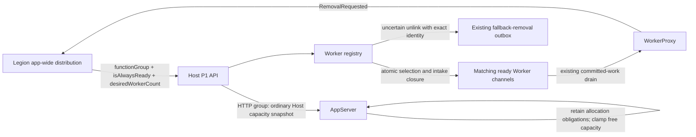
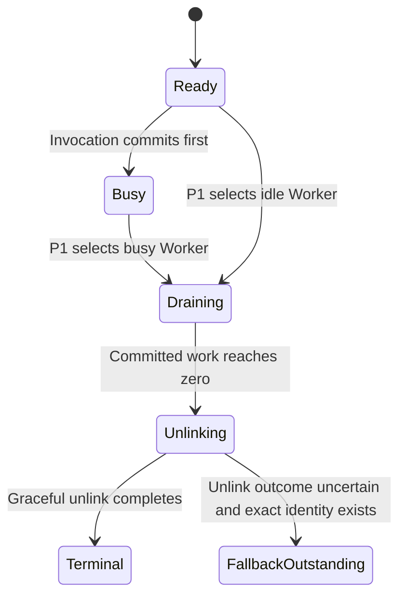
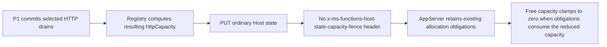

# BYOC P1 count-only Worker scale-in reviewer guide

> **Scope:** Host/WorkerProxy companion for Legion's P1 count-only Worker scale-in decision.
> **Public API:** `POST /admin/workers/scale-in`.
> **Stack:** Built directly on the existing R2 HTTP drain path, exact Worker removal fallback, and R4 Runtime retirement path.

## 1. Context

Legion already owns app-wide Worker-count distribution. It sends one local Runtime an absolute
retained count for one exact function group and always-ready class. The Host must select the excess
local Workers, close their new invocation admission before acknowledging them, and reuse the
existing drain, unlink, WorkerProxy removal, and fallback-removal lifecycle.

Before P1, the Host could:

- autonomously reserve and drain one idle HTTP on-demand Worker after AppServer applied the R2
  capacity fence;
- drain all attached Workers during R4 Runtime retirement;
- preserve exact Worker identity for uncertain-unlink fallback removal.

It could not accept an authoritative count reduction from Legion.

## 2. Non-goals

- No app-wide Worker-count distribution; Legion owns that calculation.
- No standing desired-count target, reconciliation loop, or retry policy in Host.
- No new Worker lifecycle path, per-Worker drain command, forced cancellation, or drain deadline.
- No Docker, nginx, Go AppServer scheduling, or physical pod-deletion changes.
- No reuse of the R2 `x-ms-functions-host-state-capacity-fence: required` decision for P1.

## 3. Before and after

### Before


The Host had no public count-only API. R2 chose at most one idle HTTP on-demand Worker and required
AppServer to approve the projected capacity reduction before drain commitment.

### After



## 4. Public contract

The route remains compute-only because it is discovered through the same
`ClientWorkerComposition` application part as Worker Link. It uses the existing
`AdminAuthLevel` authorization policy.

### Request

```http
POST /admin/workers/scale-in
Content-Type: application/json

{
  "functionGroup": "durable",
  "isAlwaysReady": false,
  "desiredWorkerCount": 1
}
```

The body has three contract fields:

| Field | Meaning |
| --- | --- |
| `functionGroup` | Exact function-group value assigned by WorkerProxy. Candidate matching is ordinal; the special HTTP publication policy is recognized case-insensitively to match existing platform group semantics. |
| `isAlwaysReady` | Exact Worker capacity class assigned by WorkerProxy. |
| `desiredWorkerCount` | Absolute number of matching usable local Workers to retain for this one decision. |

`desiredWorkerCount` must be zero or greater. Missing fields, malformed bodies, and negative counts
return the existing validation-errors envelope with HTTP `400`.

### Success response

```http
HTTP/1.1 200 OK
Content-Type: application/json

{
  "newlyDrainingWorkerCount": 2
}
```

`newlyDrainingWorkerCount` counts only Workers whose irreversible drain was newly committed by this
request. Already-draining, removed, or otherwise ineligible Workers are not counted again.

## 5. End-to-end flow

```mermaid
sequenceDiagram
    participant Legion
    participant API as Host scale-in API
    participant Registry as Worker registry
    participant Channel as Selected Worker channels
    participant AppServer
    participant Proxy as WorkerProxy

    Legion->>API: POST exact group, class, desired count
    API->>Registry: ScaleInWorkers(...)
    Registry->>Registry: Snapshot usable matching Workers
    Registry->>Registry: excess = max(0, usable - desired)
    Registry->>Channel: Prefer idle, then Worker ID; atomically mark draining
    Note over Registry,Channel: New invocation intake is closed before the count is returned
    Registry-->>API: newly committed count + resulting Host state

    alt HTTP function group and at least one new drain committed
        API->>AppServer: Ordinary Host-state capacity snapshot
        Note over API,AppServer: No R2 "required" capacity-fence header
        AppServer->>AppServer: Keep existing allocation obligations and clamp free capacity
    end

    API-->>Legion: 200 newlyDrainingWorkerCount
    Channel->>Channel: Wait for already committed work
    Channel->>Proxy: Existing graceful unlink
    Proxy->>Legion: Existing RemovalRequested
```

The API acknowledges selection commitment, not physical pod deletion. Drain and deletion continue
through the existing asynchronous lifecycle after the response.

## 6. Eligibility and selection

A Worker contributes to `usableCount` only when all of these are true at the decision:

- it is linked and has an initialized channel;
- function setup completed enough for invocation admission;
- its exact WorkerProxy-assigned function group matches with ordinal comparison;
- its exact WorkerProxy-assigned always-ready class matches;
- it is not reserved by R2, draining, terminal, Runtime-admission-closed, or removal-requested;
- its channel is not terminated.

Busy Workers remain usable because already committed invocations are allowed to finish. Idle is a
selection preference, not an eligibility requirement.

```mermaid
flowchart TD
    A[POST count target] --> B[Collect matching linked channels]
    B --> C{Execution-ready and non-draining?}
    C -- no --> X[Exclude]
    C -- yes --> D[usableCount]
    D --> E[excess = max(0, usableCount - desired)]
    E --> F{excess is zero?}
    F -- yes --> Z[Return newlyDrainingWorkerCount 0]
    F -- no --> I[Order idle first, then Worker ID ordinal]
    I --> K[Commit up to excess under registry and channel locks]
    K --> L[Close new intake and mark draining]
    L --> M[Return newly committed count]
```

The absolute target is evaluated once. A Worker that links or becomes ready after the decision does
not trigger another Host-local action. Legion must send a later request if another app-wide decision
is needed. The retained count is not a floor: autonomous AppServer-fenced R2 scale-in remains
independently active after P1 and can later reduce eligible idle HTTP on-demand Workers.

## 7. Deterministic ordering

Every function group, including Durable, uses the same deterministic local selection order:

1. idle Workers before busy Workers;
2. Worker ID using ordinal comparison within each activity class.

The required worker namespace and route-matching pod name on Worker Link remain independent of
ordering. They are retained only so an uncertain graceful unlink can publish the existing exact
fallback-removal action.

## 8. Atomicity and lifecycle reuse

The registry owns the decision under its existing state lock. Each selected channel revalidates the
exact group, class, readiness, and lifecycle state under the same channel lock used by invocation
admission. It then marks the channel draining before the public response can be created.



If invocation admission wins the channel lock first, that invocation remains committed and P1
drains after it finishes. If P1 wins first, later dispatch cannot enter the selected channel.

P1 calls the same `CompleteDrainAsync` and `UnlinkAsync` path as R2 and R4. It does not duplicate
WorkerProxy state transitions, fallback-removal records, or disposal logic.

## 9. HTTP Host-state publication

For the HTTP function group, the API publishes the resulting ordinary Host-state snapshot after at
least one selection commitment:



P1 is an authoritative target reduction, not a reversible autonomous R2 proposal. Therefore the
publication intentionally omits the R2 `required` capacity fence and treats an ordinary successful
AppServer response as applied.

Selection is already irreversible when publication begins. A publication rejection, transport
failure, or shared-publication-gate timeout is logged and does not change the acknowledged
newly-draining count or reopen intake. Returning an error after commitment would hide a real drain
from Legion and invite incorrect re-accounting. The complete publication attempt, including gate
acquisition, is bounded to five seconds independently of request cancellation. No-op and repeated
requests do not enqueue another publication. The existing Host-state publisher continues to expose
current state on later passes.

## 10. Ownership boundaries

| Component | Owns in P1 | Does not own |
| --- | --- | --- |
| Legion | App-wide count distribution, request delivery, aggregation of acknowledged newly-draining counts, and physical deletion. | Host-local Worker choice or invocation admission. |
| Host API | Authentication, request validation, one local count decision, response count, and HTTP ordinary-state publication. | Standing convergence or app-wide retries. |
| Worker registry/channel | Exact eligibility, deterministic idle/Worker-ID ordering, atomic intake closure, drain, unlink, and fallback-removal reuse. | App-wide count allocation or physical pod deletion. |
| WorkerProxy | Authoritative function-group/class capabilities and existing sticky removal state. | Host-local selection. |
| AppServer | Ordinary Host-state consumption, existing allocation obligations, and free-capacity calculation. | P1 Worker selection or approval fencing. |

## 11. Mixed-version behavior

| Combination | Behavior |
| --- | --- |
| Required Link worker coordinates | Resource namespace and route-matching pod name enable existing fallback-removal behavior without affecting P1 ordering. |
| Older AppServer | Receives an ordinary Host-state request with no new JSON fields and no P1-specific fence requirement. |
| Repeated P1 request | Already-draining or deleted Workers are absent from usable count and are not counted again. |
| Mixed-case `HTTP` assignment | Exact matching still requires the request to use the same value; special HTTP publication is recognized case-insensitively. |

## 12. Assumptions

- Legion sends a local desired count after it has performed app-wide distribution.
- WorkerProxy capability replacement remains the trusted source of function group and always-ready
  class.
- A successful response acknowledges irreversible Host-local drain commitment, not drain completion
  or deletion.
- AppServer preserves existing allocation obligations when ordinary HTTP capacity decreases.
- Ignoring request cancellation after drain commitment for the independently bounded five-second
  AppServer publication avoids reporting an ambiguous partial result.
- P1 does not disable autonomous R2; the one-shot retained count is not a lasting minimum.

## 13. Known limitations

- There is no standing target or Host retry loop; later changes require a later Legion request.
- The API does not wait for committed invocations, graceful unlink, fallback acknowledgement, or
  physical deletion before returning.
- Existing drain and unlink paths still have no forced invocation deadline.
- Ordinary HTTP state publication is best effort and bounded to five seconds after irreversible
  commitment.
- No-op requests intentionally skip Host-state publication because capacity did not change.
- This PR does not validate deployment ordering or real private-stamp behavior.

## 14. File-by-file change map

| File | Review purpose |
| --- | --- |
| `Functions.Host/Controllers/WorkerScaleInController.cs` | Public authenticated POST contract, validation, response, and best-effort ordinary HTTP state publication. |
| `Functions.Host/Models/WorkerScaleInRequest.cs` | Three-field request and one-field response wire shapes. |
| `Functions.Host/HostState/IWorkerScaleInStatePublisher.cs` | Narrow public controller dependency for ordinary Host-state publication. |
| `Functions.Host/HostState/AppServerHostStateClient.cs` | Adds no-fence ordinary publication while preserving R2 and R4 fence behavior. |
| `Functions.Rpc.Client/ScaleIn/IWorkerCountScaleInManager.cs` | Narrow P1 selection contract and result shape. |
| `Functions.Rpc.Client/Registry/WorkerChannelRegistry.cs` | Computes excess once, orders idle then Worker ID, commits selection, and reuses drain/unlink/fallback. |
| `Functions.Rpc.Client/WorkerChannel/RpcClientWorkerChannel.cs` | Revalidates exact eligibility and atomically closes invocation intake. |
| `Functions.Rpc.Client.Tests/Registry/WorkerChannelRegistryTests.CountScaleIn.cs` | Five public-API behavioral tests through TestServer and real registry/channel lifecycle. |

## 15. Behavioral validation

The five added public-API behavioral methods cover:

1. exact group/class isolation plus Starting/readiness-ineligible exclusion;
2. desired count at current, deterministic HTTP reduction, repeated request, and no-fence HTTP
   publication;
3. zero Durable target;
4. positive Durable selection with idle preference followed by ordinal Worker ID;
5. invalid request rejection plus positive Durable selection with required worker coordinates.

Council findings incorporated before final validation:

- special HTTP publication classification is case-insensitive while candidate matching remains
  exact;
- the complete post-commit publication attempt is bounded, no-op requests skip publication, and
  publication failure still returns the committed count;
- the controller depends on a narrow `IWorkerCountScaleInManager` rather than expanding the root
  registry interface;
- deterministic ordering applies uniformly to every function group, including Durable;
- P1's one-shot retained count is explicitly not a floor over later autonomous R2 decisions.

Final local evidence:

- `dotnet build src\Functions.Host\Functions.Host.csproj -c Debug --no-restore --nologo`
  - Result: passed with zero warnings.
- `dotnet build test\Functions.Rpc.Client.Tests\Functions.Rpc.Client.Tests.csproj -c Debug --no-restore --nologo`
  - Result: passed with zero warnings.
- `dotnet build test\Functions.Host.Tests\Functions.Host.Tests.csproj -c Debug --no-restore --nologo`
  - Result: passed with zero warnings.
- `dotnet test test\Functions.Rpc.Client.Tests\Functions.Rpc.Client.Tests.csproj -c Debug --no-build --no-restore --filter "FullyQualifiedName~WorkerChannelRegistryTests.PostScaleIn|FullyQualifiedName~WorkerChannelRegistryTests.PostRuntimeDrain" --nologo`
  - Result: passed, 11/11.
- `dotnet test test\Functions.Rpc.Client.Tests\Functions.Rpc.Client.Tests.csproj -c Debug --no-build --no-restore --filter "FullyQualifiedName~WorkerChannelRegistryTests|FullyQualifiedName~RuntimeRetirementManagerTests" --nologo`
  - Result: passed, 125/125.
- `dotnet test test\Functions.Host.Tests\Functions.Host.Tests.csproj -c Debug --no-build --no-restore --filter "FullyQualifiedName~WorkerLink|FullyQualifiedName~ClientWorkerCompositionTests" --nologo`
  - Result: passed, 159/159.
- `git diff --check`
  - Result: passed.

These are local in-memory public-API behavioral tests. They do not replace a private-stamp
Host/AppServer/WorkerProxy/Legion validation.
