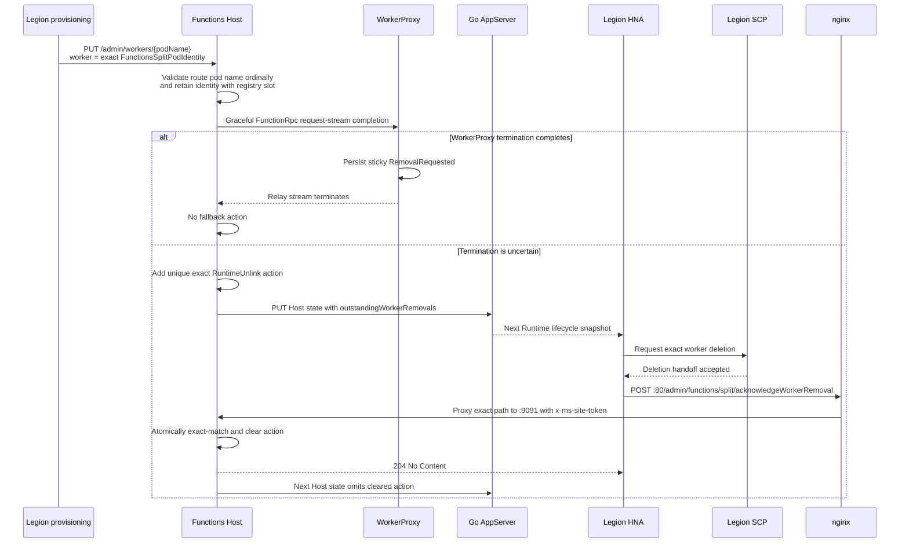
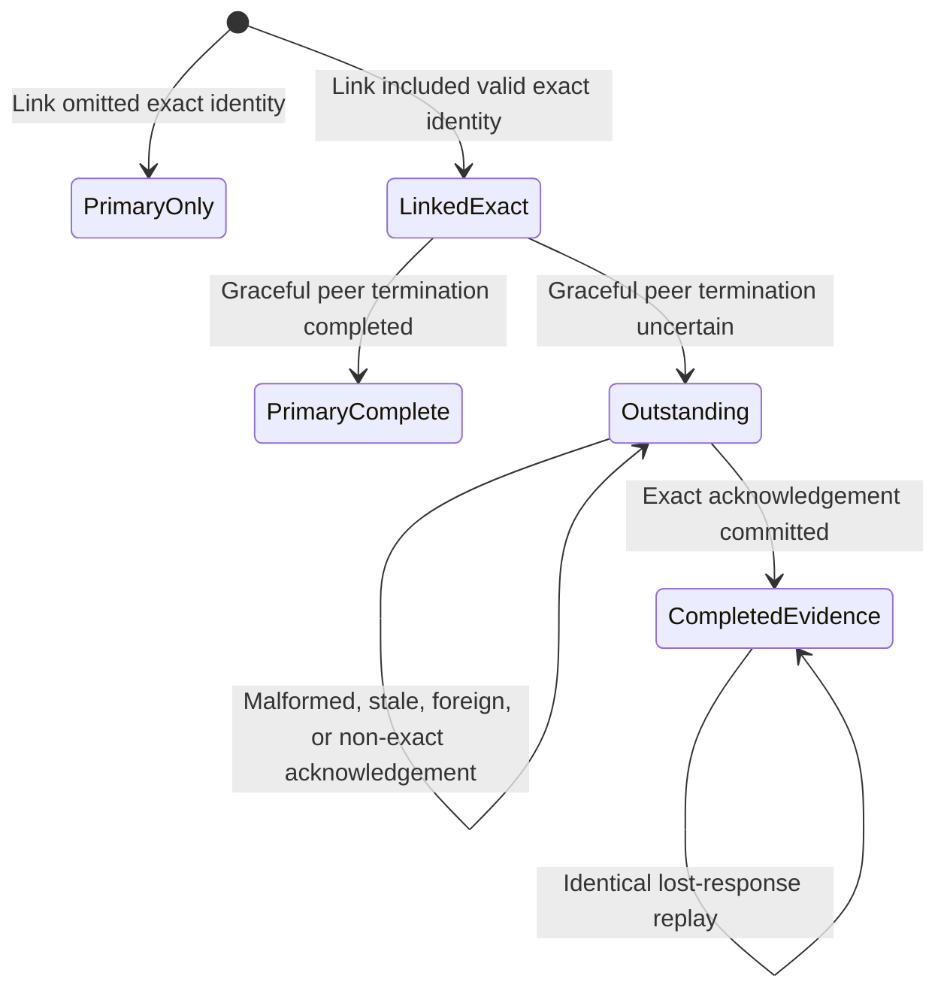

# BYOC Runtime worker-removal fallback

## Context

WorkerProxy sticky `RemovalRequested` remains the primary worker-removal handoff. Runtime uses
`outstandingWorkerRemovals` only when a graceful unlink started but WorkerProxy termination did not
finish reliably enough to prove that primary handoff.

The fallback action is not a request based on a worker name. It contains the exact immutable worker
physical identity created by Legion:

- resource namespace
- pod name
- pod GUID
- Legion stamp name
- `FunctionsSplitWorkerPod` pod type
- Function App name, site ID, and Antares stamp name
- a frozen bounded reason (`RuntimeUnlink`)

Runtime never derives these values from a pod name, endpoint, app setting, or same-app match.

## Ownership

| Component | Responsibility |
| --- | --- |
| Legion provisioning and Link path | Construct one `FunctionsSplitPodIdentity` from allocation `PodInfo` plus the original `FunctionAppIdentifier`, then forward it unchanged to Runtime. |
| Functions Host root registry | Validate and retain optional exact worker identity, own the authoritative fallback outbox, match acknowledgements, and retain bounded duplicate evidence. |
| Host-to-AppServer state transaction | Publish the current outbox with the existing capacity snapshot. |
| Go AppServer | Reflect the next Host lifecycle snapshot without creating, changing, or clearing removal actions. |
| Legion HNA/NNA | Observe actions, request SCP deletion, and acknowledge the exact action after accepted deletion handoff. |
| nginx | Proxy the exact acknowledgement path from Runtime pod port 80 to Host port 9091 while preserving the existing site-token authentication header. |

## Flow

The acknowledgement means Legion accepted a recoverable deletion handoff. It does not mean the
worker pod has physically finished deleting. Clearing the fallback action does not reopen worker
admission, clear WorkerProxy retirement, or change the terminal worker slot.

## Host state and acknowledgement rules

- Link identity is optional for mixed-version compatibility.
- When identity is present, `worker.podName` must equal the route worker ID with ordinal comparison.
- Only an identity-bearing slot can create a fallback action.
- A successful WorkerProxy stream termination never creates a fallback action.
- Runtime publishes each action until an exact acknowledgement is committed.
- Matching uses the full action, including every worker and app incarnation field and the reason.
- Malformed acknowledgements return `400`; valid unknown or non-exact actions return `404`.
- The first exact acknowledgement and a retained identical replay return `204`.
- Completed evidence is private, process-local, and bounded to 128 exact actions.
- The root registry keeps pending actions across ScriptHost child restarts in the same Runtime process.
- Runtime process restart durability is not provided. A stale acknowledgement sent to another Runtime
  process cannot clear state because that process has no matching outbox action.

Both Link and acknowledgement use the existing Host admin authorization policy. No new credential is
introduced. The existing Legion `LinkFunctionsWorker` path already sends the Runtime container's
`SiteTokenHeader` from pod infrastructure connectivity, so enabling the Host policy does not require
a caller contract change.

## Mixed-version behavior

| Combination | Behavior |
| --- | --- |
| Old Legion caller -> new Host | Link omits `worker`; primary WorkerProxy removal continues and Runtime fallback stays disabled for that slot. |
| New Legion caller -> old Host | The additive `worker` JSON field is ignored; primary removal continues without Runtime fallback. |
| New Host -> AppServer without outbox reflection | AppServer R2's Go JSON decoder ignores the additive field, so existing capacity publication continues. Host retains and periodically republishes actions, but Legion cannot observe them until AppServer gains reflection support. |
| Host/AppServer without the nginx exact route | Legion's port-80 acknowledgement cannot reach Host 9091. The Docker companion change is required before fallback is operational. |

## Required companion contracts

### Legion

At worker creation, build `FunctionsSplitPodIdentity` from:

- `StampCreateAndAllocatePodResponse.PodInfo`: resource namespace, pod name, pod GUID, and Legion stamp
- the original `CreateFunctionsSplitWorkerRequest.FunctionAppPodContext.FunctionAppIdentifier`
- `FunctionsPodType.FunctionsSplitWorkerPod`

Preserve that typed value unchanged through:

1. `CreateFunctionsSplitWorkerResponse`
2. `FunctionsSplitProvisioningService.LinkSplitWorkerAsync`
3. `RegionalLinkFunctionsWorkerRequest`
4. `FunctionsWorkerLinkService.CreateRuntimeRequest`
5. `FunctionsWorkerLinkRequest`
6. Regional-to-Stamp, Stamp-to-HostRole, HostRole-to-NestedRole, and NNA forwarding contracts
7. Runtime `PUT /admin/workers/{workerId}` as nullable JSON property `worker`

Legion tests should prove the creation response uses the exact allocation/app values, every typed hop
preserves equality, the final Runtime request has the exact JSON shape, and an older request without
`worker` remains valid.

### Go AppServer

Extend the existing Host-state request and Runtime lifecycle snapshot with
`outstandingWorkerRemovals`. Tests should prove exact round-trip reflection, independent removal of one
action from a multi-action snapshot, and compatibility when the field is omitted.

The AppServer R2 base at `b43f1c5cbfc8116065a80f4f2b2b87211859dfe7` uses Go's default
`json.Decoder` without `DisallowUnknownFields`, so this additive Host field is accepted before the
reflection companion deploys.

### Docker nginx

Runtime pod port 80 needs one narrow exact route:

`/admin/functions/split/acknowledgeWorkerRemoval` -> Functions Host port `9091`

The route must not require `x-site-deployment-id`, because NNA sends `x-ms-site-token`. It must preserve
that token for Host admin authentication and must not route this API through Go AppServer port 6060.

The companion is draft ADO PR
[17739315](https://msazure.visualstudio.com/DefaultCollection/One/_git/AAPT-Antares-Functions-Docker/pullrequest/17739315),
source head `59f5d37abce0fb658a82cbb825449a7a1ff61461`, stacked on AppServer R2 head
`b43f1c5cbfc8116065a80f4f2b2b87211859dfe7`. It covers both HTTP and TLS nginx templates.

## Validation boundary

Repository tests exercise the real Host registry, FunctionRpc close behavior, Host-state JSON
publication, and management controller in memory. They are not deployed evidence. End-to-end
validation still requires coordinated Legion, AppServer, and Docker images on a private stamp.
