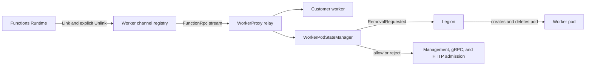
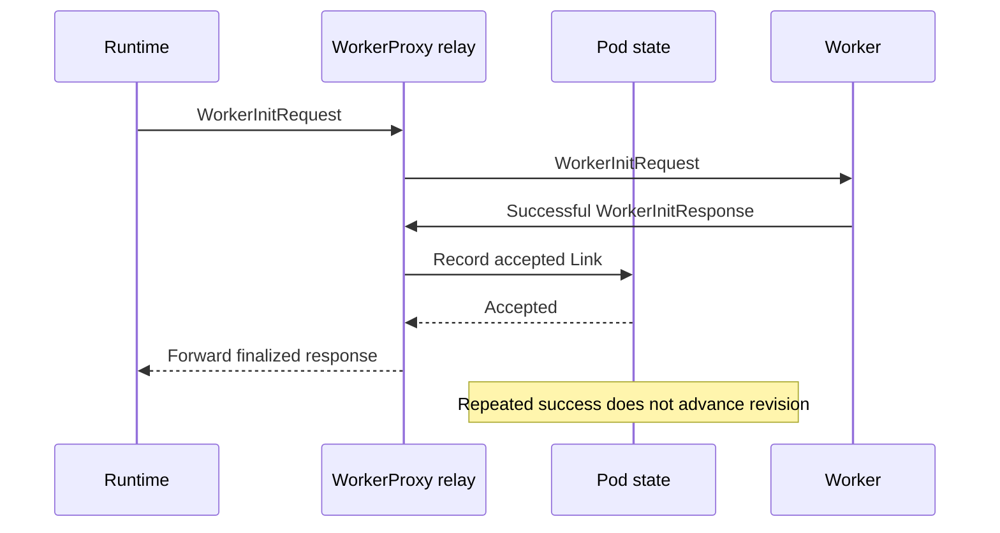
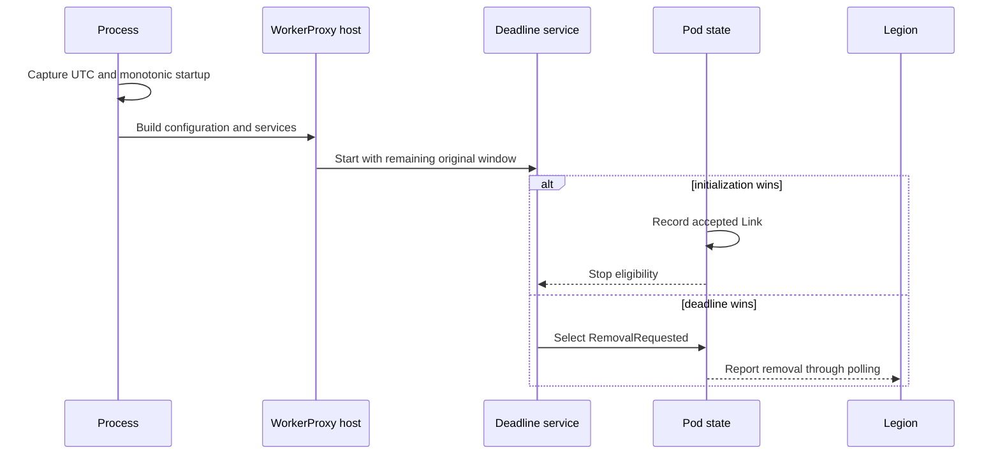
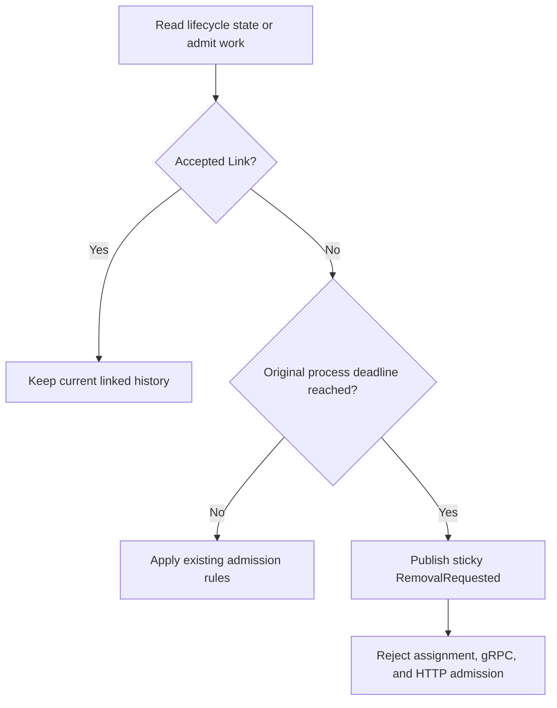
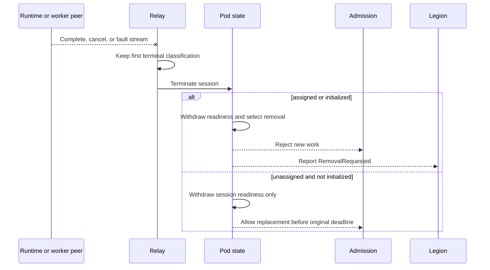
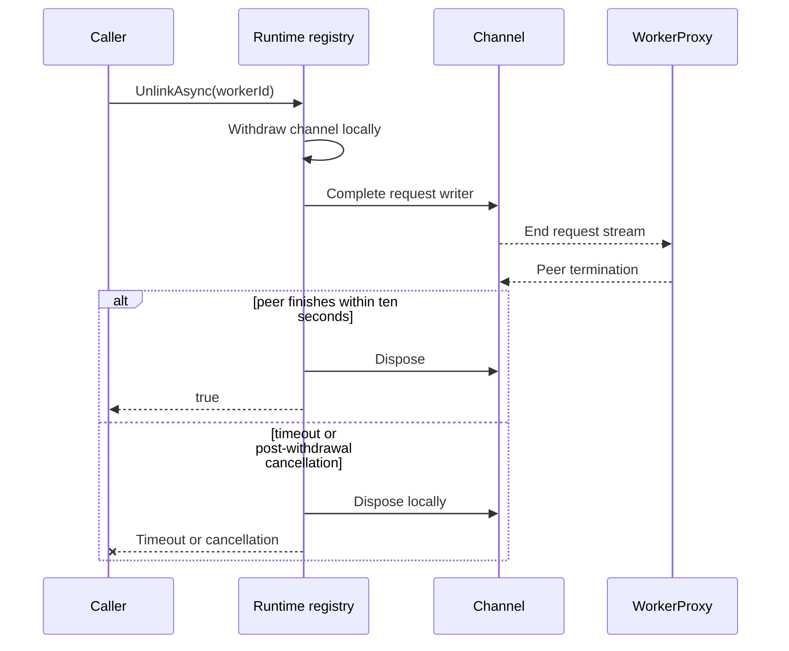

# BYOC worker lifecycle cleanup reviewer guide

> **Scope:** Functions Host Runtime client and WorkerProxy lifecycle behavior.
> **Purpose:** Explain the change by behavior so reviewers do not need to reconstruct it from code.
> **Dependency:** Azure/azure-functions-host#12103 is still required to authenticate
> `FunctionRpc/EventStream` in the deployed BYOC flow.

## 1. Problem statement

A BYOC worker pod can become unusable without a clear local cleanup decision:

- The worker may never finish initialization.
- An assigned or initialized Runtime-to-worker relay may terminate.
- Runtime may remove a worker locally without completing its request stream.
- A removal decision may be published while another admission path still accepts work.

Before this change, these cases relied on external recovery or abortive disposal. The change gives
WorkerProxy one durable local lifecycle decision: once the pod cannot safely serve or be reused, it
publishes sticky `RemovalRequested` and closes new work admission. Legion still owns physical pod
deletion.

## 2. Terms

| Term | Simple definition |
| --- | --- |
| Runtime | The Functions Host process that owns the Runtime-side worker registry. |
| WorkerProxy | The sidecar that relays FunctionRpc traffic to the customer worker. |
| Worker | The customer language worker process behind WorkerProxy. |
| Link | The platform operation that connects Runtime to a WorkerProxy worker channel. |
| Relay session | One paired Runtime stream and worker stream inside WorkerProxy. |
| Accepted Link | A successful worker initialization response on the current paired streams. |
| Never-linked deadline | A fixed process-start window for reaching accepted Link. |
| Sticky removal | Once selected, `RemovalRequested` cannot be reversed in that process. |
| Admission | A new assignment, gRPC stream, Link attempt, or HTTP forwarding request. |

## 3. Ownership

| Owner | Responsibility in this change | Not owned here |
| --- | --- | --- |
| `WorkerPodStateManager` | Link history, fixed deadline, lifecycle state, sticky removal. | Physical deletion. |
| `FunctionRpcRelay` | Pair streams and classify terminal completion, cancellation, or fault. | General network health detection. |
| WorkerProxy management/HTTP | Reject new work after removal is selected. | Draining already-admitted invocations. |
| Runtime worker registry | Withdraw locally, complete requests, wait for peer termination, dispose. | Proof that the remote pod was deleted. |
| Legion | Observe `RemovalRequested` and reclaim the pod. | FunctionRpc stream ownership. |

## 4. Before and after

| Scenario | Before | After |
| --- | --- | --- |
| Worker initializes successfully | No retained local Link history. | Accepted Link history is recorded once and retained. |
| Worker never initializes | The pod could remain until external recovery. | A fixed process-start deadline requests removal. |
| Assigned relay terminates before initialization | Assignment becomes unusable but cleanup can wait. | Terminal peer loss requests removal immediately. |
| Initialized relay terminates | The attachment is gone but the pod may still look reusable. | The pod requests removal and cannot be retargeted. |
| Runtime explicitly unlinks | Disposal aborts the stream. | Runtime completes requests and waits up to ten seconds. |
| Removal is published | Some override-based HTTP traffic can still find a destination. | Management, gRPC, readiness, and HTTP admission close consistently. |

## 5. Selected behavior

### 5.1 Record successful initialization history

**What changed:** WorkerProxy records accepted Link when a successful `WorkerInitResponse` is
forwarded on the current live Runtime/worker stream pair. Repeated success is idempotent.

**Why this is needed:** Terminal cleanup must distinguish a session that was locally initialized
from an unassigned session that can still recover by replacing its streams.

**How it works:** The relay and pod state share the existing lifecycle lock order. Successful
initialization records `HasAcceptedLink` before the response reaches Runtime. The public Link
projection remains `Unlinked` because authoritative Runtime identity publication is not part of this
change.

### 5.2 Use one fixed never-linked deadline

**What changed:** Process entry captures UTC startup time and a monotonic timestamp before Host and
configuration construction. `WorkerProxy:NeverLinkedTimeout` defaults to five minutes and is frozen
when the state manager is created.

**Why this is needed:** Construction time, retries, assignment, failed initialization, or
configuration reload must not accidentally grant a new lifetime window to an abandoned pod.

**How it works:** The hosted timeout service and every lifecycle admission check use the same
original monotonic deadline. Successful initialization and expiry serialize under the lifecycle
lock, so only one outcome wins.

### 5.3 Remove terminal assigned or initialized relays

**What changed:** Existing `PeerClosed`, `Canceled`, and `Faulted` terminal classifications request
removal when the session has an accepted assignment or accepted Link.

**Why this is needed:** An assigned session is permanently failed after terminal relay loss, and an
initialized WorkerProxy cannot safely accept a replacement attachment. Waiting for the never-linked
deadline only delays cleanup of an unusable pod.

**How it works:** Relay termination withdraws readiness, fails the assignment when present, and
selects sticky removal in one state revision. An unassigned session without accepted Link keeps its
original recovery behavior and original deadline. Proxy shutdown does not independently select
removal; the first terminal classification still wins.

**W2 scope boundary:** This PR handles terminal relay/session outcomes through the existing
`PeerClosed`, `Canceled`, and `Faulted` classifications. The broader policy for distinguishing a
transient connection disruption from terminal connection loss remains outside this PR.

### 5.4 Complete Runtime requests during explicit unlink

**What changed:** `IWorkerChannelRegistry.UnlinkAsync` withdraws the channel locally, completes the
request writer, waits up to ten seconds for peer termination, then disposes the channel.

**Why this is needed:** Graceful request completion lets a healthy WorkerProxy observe a real peer
close and run its existing terminal cleanup path instead of only seeing local cancellation.

**How it works:** Local withdrawal happens before the wait, so no new Runtime work can use the
channel. After withdrawal, timeout, caller cancellation, or registry shutdown still disposes local
resources and keeps the worker ID terminal. Cancellation before withdrawal leaves the channel linked.

### 5.5 Close admission consistently

**What changed:** Sticky removal rejects assignment with HTTP 409, rejects new FunctionRpc streams,
withdraws worker readiness, returns HTTP 503 for new forwarding requests, and ignores an explicit
HTTP destination override.

**Why this is needed:** A removal decision is unsafe if another public path can still admit work to
the same pod.

**How it works:** Every admission path reads the same pod lifecycle state. Management readiness and
state polling remain available so Legion can observe and act on removal.

**W3 scope boundary:** This PR does not claim the full customer-process and mandatory-endpoint
health-classification policy. It only acts on the explicit lifecycle and admission signals described
in this guide.

## 6. Assumptions

| Assumption | Reason |
| --- | --- |
| A successful initialization response on the live pair is the local accepted-Link point. | It is the existing protocol milestone shared by Runtime and worker. |
| An assigned terminal relay cannot be reused. | The assignment is already permanently failed. |
| An initialized terminal relay cannot be retargeted in the same WorkerProxy. | Local Link history is retained for process lifetime. |
| The monotonic `TimeProvider` timestamp is stable for the process. | Deadline correctness must not depend on UTC clock changes. |
| Legion polls state and owns deletion after `RemovalRequested`. | WorkerProxy does not delete its own pod. |
| Ten seconds is an acceptable bound for graceful Runtime unlink. | It bounds peer waiting while guaranteeing local disposal. |

## 7. Known limitations and non-goals

| Limitation or non-goal | Current boundary |
| --- | --- |
| Runtime-to-WorkerProxy authentication | Depends on Azure/azure-functions-host#12103; not validated end to end here. |
| Deployed E2E validation | Not performed by this change. Local loopback tests are not deployed evidence. |
| Linux and Native AOT publishing | Not validated by the Windows test runs. |
| Physical pod reclamation | Legion behavior is outside this repository change. |
| Committed invocation settlement | Already-admitted requests may continue; this is not an atomic drain barrier. |
| Runtime identity publication | Public `link.runtime` remains unset and `link` remains `Unlinked`. |
| W2 transient-versus-terminal policy | Only existing terminal relay/session classifications select cleanup; broader connection-loss policy is deferred. |
| W3 health-classification policy | Full customer-process and mandatory-endpoint health classification is deferred. |
| WorkerProxy startup failure | A process that never starts or cannot report still needs Legion recovery. |
| Remote unlink acknowledgement | Runtime success means local cleanup, not proof of remote deletion. |

The W2 and W3 boundaries above are accepted review scope for this PR, not unresolved blockers.

## 8. Scenario mapping

| Lifecycle situation | Expected result |
| --- | --- |
| Successful, repeated, or metadata-only initialization | Record history once; do not publish Runtime identity. |
| Failed or unpaired initialization | Keep unlinked replacement behavior. |
| Deadline after construction, retries, or reload | Select the same original expiry. |
| Initialization races expiry | Exactly one lifecycle outcome wins. |
| Assigned or initialized peer closes, cancels, or faults | Select sticky removal. |
| Unassigned peer closes, cancels, or faults | Allow replacement until the original deadline. |
| Removal already selected | Reject management, gRPC, readiness, and HTTP admission. |
| Another WorkerProxy is healthy | Keep the sibling eligible and forwarding. |
| Explicit Runtime unlink completes | Complete requests, observe peer close, and release local state. |
| Explicit Runtime unlink times out or is canceled | Report failure after local cleanup. |

## 9. Behavioral test matrix

The PR adds exactly five top-level behavioral test methods. Scenario helpers and theory rows keep
the matrix readable without adding private-helper unit tests.

| Top-level test | Public boundary | Main coverage |
| --- | --- | --- |
| `LinkAcceptance_InitializationHistoryAndReplacementFollowPublicLifecycleContract` | Real WorkerProxy gRPC and management HTTP | Success, repetition, metadata-only history, failed/unpaired replacement, retarget rejection. |
| `NeverLinkedDeadline_UsesFixedProcessStartAndStickyAdmission` | WorkerProxy management, gRPC, readiness, and HTTP | Process-start expiry, construction, reload, retries, accepted Link, expiry race. |
| `PeerTermination_AssignedInitializedAndUnassignedSessionsFollowLifecyclePolicy` | Real WorkerProxy gRPC and management HTTP | Both peers, close/cancel/fault, assigned and initialized cleanup, unassigned recovery. |
| `RemovalAdmission_IsStickyAcrossPublicSurfacesAndIsolatedPerProxy` | WorkerProxy management, gRPC, HTTP, and two app instances | Sticky rejection, explicit HTTP override, sibling isolation, shutdown, initialization-close race. |
| `UnlinkAsync_RealGrpcPreservesPostWithdrawalLocalOwnership` | Public Runtime registry over real loopback gRPC | Graceful close, peer status, timeout, cancellation, shutdown, terminal local cleanup. |

## 10. File map

| Area | Files | Reviewer focus |
| --- | --- | --- |
| Runtime unlink contract | `IWorkerChannelRegistry.cs`, `WorkerChannelRegistry.cs`, `RpcClientWorkerChannel.cs` | Local withdrawal ordering, peer wait, disposal on every outcome. |
| WorkerProxy lifecycle state | `WorkerPodStateManager.cs`, `WorkerPodState.cs`, `WorkerProxyStartupTime.cs` | One lock, fixed deadline, sticky removal, retained history. |
| Relay classification | `FunctionRpcRelay.cs`, `FunctionRpcRelay.Session.cs` | First terminal result, assigned/initialized cleanup, unassigned recovery. |
| Admission | `ManagementApiHandlers.cs`, `WorkerHttpForwardingMiddleware.cs` | Consistent 409/503/gRPC rejection while polling stays available. |
| Hosting/configuration | `Program.cs`, `WorkerProxyApplication.cs`, `WorkerProxyOptions.cs` | Startup capture before construction and one frozen timeout value. |
| Behavioral tests | WorkerProxy relay tests and Runtime registry tests | Five public-boundary methods and their scenario matrices. |

## 11. Rollout and dependency notes

1. The change adds no new endpoint or wire message.
2. `WorkerProxy:NeverLinkedTimeout` defaults to five minutes and must be positive.
3. Mixed lifecycle behavior remains conservative: unassigned sessions can recover; assigned or
   initialized terminal sessions retire.
4. Rollback is a normal binary rollback. Existing state is process-local and is not persisted.
5. Do not deploy this WorkerProxy behavior until Azure/azure-functions-host#12103 or equivalent
   network enforcement authenticates the Runtime-facing stream.
6. Deployed validation must separately prove authenticated W1 completion and Legion reclamation.

## 12. Reviewer checklist

- Confirm successful initialization is the correct local accepted-Link milestone.
- Confirm process construction and retries never reset the deadline.
- Confirm terminal assigned/initialized sessions cannot be reused safely.
- Confirm unassigned recovery and healthy sibling behavior remain unchanged.
- Confirm every post-removal admission path closes while management polling remains available.
- Confirm Runtime unlink always releases local state, including timeout and cancellation.
- Confirm the limitations in section 7 are acceptable rollout gates.
