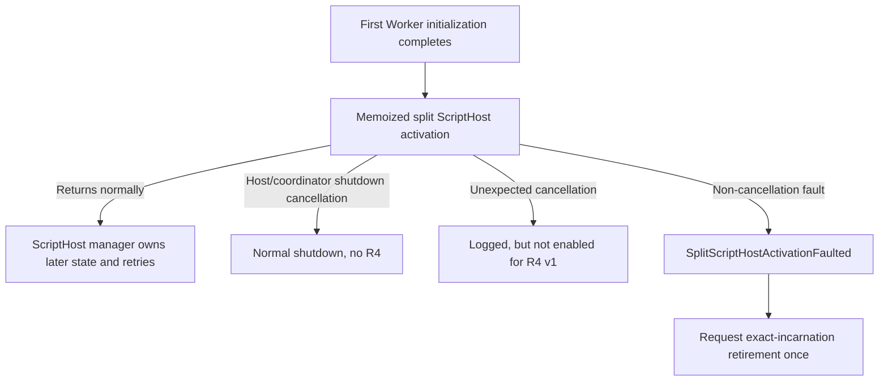
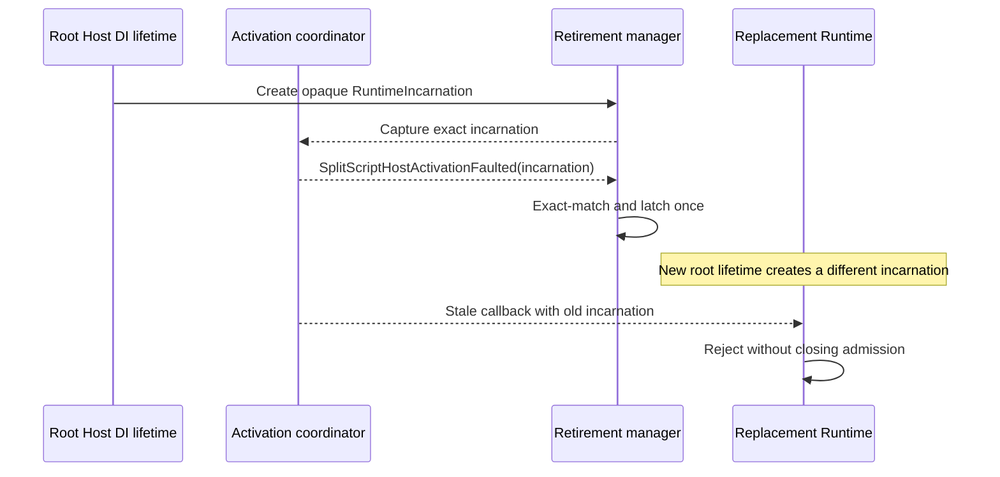
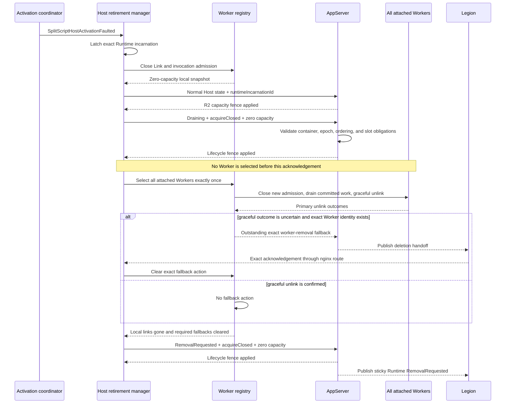
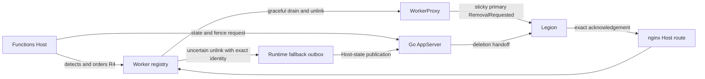
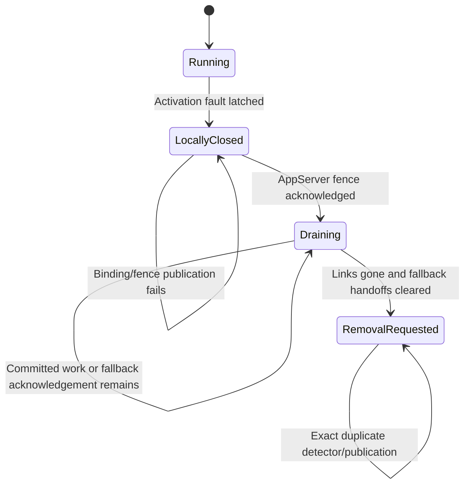

# Runtime activation-fault self-retirement reviewer guide

> **Scope:** The first Host-initiated Runtime self-retirement slice for compute separation.
> **Detector:** `SplitScriptHostActivationFaulted` only.
> **Boundary:** The first initialized Worker has linked, but the memoized split ScriptHost activation task faults.

## 1. Why retirement is required

The root Host process stays alive when split ScriptHost activation fails. The activation coordinator
memoizes that first activation task, so later `StartAsync` calls and Worker Links observe the same
terminal result instead of creating a fresh ScriptHost activation attempt. That Runtime incarnation
cannot recover in place.

R4 turns this one terminal Host-local condition into an ordered retirement:

1. Latch retirement for the exact Host-process incarnation.
2. Irreversibly close new Worker Link and invocation admission.
3. Bind the Host incarnation to AppServer, then request `Draining`, zero capacity, and
   `acquireClosed`.
4. Wait for AppServer's existing capacity-fence acknowledgement.
5. Select every attached Worker together once, drain committed work, and use graceful unlink.
6. Wait for any required exact worker-removal fallback acknowledgements.
7. Publish sticky Runtime `RemovalRequested`.

The outer Host remains alive throughout this flow. Legion remains the deletion executor.

## 2. Detector and explicit non-detectors

R4 v1 does not inspect or infer retirement from:

- Host performance counters;
- `ScriptHostState.Error` or retry counts;
- generic exceptions outside the activation coordinator;
- TokenService, WorkerProxy, or AppServer failures;
- external Legion or Antares health;
- Host process termination;
- a public `MarkUnhealthy` API.

Manager-owned `Error` or retry-in-progress remains recoverable because the initial
`IHostedService.StartAsync` call returned normally. Unexpected activation cancellation is logged but
is intentionally not an R4 v1 detector.

## 3. Exact Runtime incarnation

The Host has no authoritative Runtime pod GUID, startup time, or lifecycle revision. WorkerProxy's
pod identity is not available to the Host and must not be inferred. R4 therefore creates one opaque
`RuntimeIncarnation` GUID for the root Host dependency-injection lifetime.

The startup coordinator captures that value before activation. Every callback and state transition
must exact-match it. A stale activation callback is ignored if the retirement manager owns a
different incarnation.

AppServer receives the same opaque value as `runtimeIncarnationId`, together with the existing
`x-ms-functions-container-name` header. AppServer treats it as a Host-process epoch, not as the
Legion pod GUID.

## 4. Ordered retirement

The normal incarnation-binding request uses `PUT /admin/infra/host/state` with the existing
`x-ms-functions-host-state-capacity-fence: required` value, no lifecycle fields, and the current
`runtimeIncarnationId`.

The later AppServer lifecycle request uses the same path with:

- `x-ms-functions-container-name: <CONTAINER_NAME>`;
- `x-ms-functions-host-state-capacity-fence: lifecycle-required`;
- existing `createdTime`, `linkedWorkerCount`, and `httpCapacity`;
- `runtimeIncarnationId`;
- `status: Draining` or `status: RemovalRequested`;
- `acquireClosed: true`.

The distinct lifecycle fence value prevents an older R2 AppServer from ignoring the new JSON fields
and returning a false `applied` acknowledgement. AppServer returns
`x-ms-functions-host-state-capacity-fence: applied` only after acquisition is closed under the same
lock used for Worker Links and slot grants. The lifecycle request must carry a newer `createdTime`
than the normal incarnation-binding publication. Exact replay of the full accepted snapshot is
idempotent.

## 5. Worker ownership and fallback direction

| Component | R4 responsibility | Explicitly not owned |
| --- | --- | --- |
| Activation coordinator | Emit the one typed detector with the captured incarnation. | Health classification elsewhere. |
| Host retirement manager | Latch, order, and await each irreversible boundary. | Physical deletion. |
| Worker registry | Close local admission, select all attached Workers once, drain, unlink, and retain fallback actions. | AppServer acquisition policy. |
| WorkerProxy | Keep sticky primary `RemovalRequested` behavior. | Detecting Host activation failure. |
| AppServer | Bind Host epoch, atomically fence acquisition, acknowledge the fence, and publish Runtime lifecycle state. | Detecting R4 or calling Host to begin it. |
| Legion | Execute Worker and Runtime deletion and acknowledge accepted Worker fallback handoffs. | Host-local draining. |

WorkerProxy sticky `RemovalRequested` remains primary. The Runtime fallback outbox is used only when
an identity-bearing Worker's graceful unlink outcome is uncertain. Links from older callers that
omit exact Worker identity keep primary-removal-only behavior; R4 cannot report complete retirement
if such an unlink is uncertain.

## 6. Failure semantics

| Failure | Result |
| --- | --- |
| Incarnation binding fails | Host remains locally closed; no Worker selection; R4 is incomplete. |
| AppServer rejects or does not acknowledge the drain fence | Host remains locally closed; no Worker selection; R4 is incomplete. |
| AppServer returns 400, 409, or 412 | The request is mutation-free and unacknowledged; Host remains locally closed and R4 is incomplete. |
| A committed invocation does not finish | Runtime remains fenced in `Draining`; no forced deadline or cancellation is added. |
| Graceful unlink is uncertain and exact Worker identity exists | Runtime waits for the existing fallback handoff acknowledgement. |
| Graceful unlink is uncertain and exact Worker identity is absent | Runtime remains fenced and R4 is incomplete. |
| Final `RemovalRequested` publication fails | Runtime remains locally closed with no links; retirement is not reported as complete. |
| Duplicate detector delivery | Existing latch, drain selection, and progress are reused without reset. |
| Stale detector delivery | Exact-incarnation mismatch rejects it without affecting the replacement Runtime. |

This first slice does not restart or retry a faulted retirement task. That preserves one-shot
selection and prevents duplicate detector delivery from replaying irreversible work. Publication
failure therefore remains an explicit incomplete, locally closed state for external supervision or
Runtime replacement rather than a success-shaped retry loop.

## 7. Compatibility and rollout

| Participant | Older version behavior | R4 behavior |
| --- | --- | --- |
| Older Worker Link caller | Omits exact Worker identity; primary WorkerProxy removal remains available. | Identity-bearing links additionally support the fallback outbox. |
| Older AppServer R2 | Accepts legacy Host-state requests with no new lifecycle fields. It cannot acknowledge `lifecycle-required`. | R4 fails closed instead of treating ignored lifecycle JSON as success. |
| New AppServer with legacy Host | New fields are optional; R2 behavior is unchanged. | Incarnation-bearing normal publication binds the Host-process epoch. |
| Legion | Continues passive deletion based on published state. | Also acknowledges accepted exact Worker fallback handoffs. |

Required companion changes:

- Runtime worker-removal fallback/outbox in draft GitHub PR
  [#10](https://github.com/manikantanallagatla/azure-functions-host/pull/10), source
  `d4f922c402d9ed6d0a42689818b8385eacccc425`.
- AppServer R4 epoch and lifecycle fence support in draft ADO PR
  [17739670](https://msazure.visualstudio.com/DefaultCollection/One/_git/AAPT-Antares-Functions-Docker/pullrequest/17739670),
  source `30619f9b8cd7151b2c0282cb0697afa6bb11d1c6`, stacked on AppServer R2
  `b43f1c5cbfc8116065a80f4f2b2b87211859dfe7`.
- nginx acknowledgement routing in ADO PR
  [17739315](https://msazure.visualstudio.com/DefaultCollection/One/_git/AAPT-Antares-Functions-Docker/pullrequest/17739315),
  source `59f5d37abce0fb658a82cbb825449a7a1ff61461`, which routes the exact Host
  acknowledgement path to port 9091 and does not expose Go port 6060.

No additional Docker contract or Host transport workaround is required beyond those companion PRs.
Go AppServer remains only the authenticated fence/state-publication participant and never calls Host
to initiate retirement.

Activation must remain disabled until the Host, AppServer, nginx route, and Legion acknowledgement
consumer are deployed in a compatible order. Rolling back the detector stops new R4 decisions;
already fenced or removal-requested incarnations remain terminal.

## 8. Non-goals

- No performance-counter, retry-count, generic exception, or external health detector.
- No unexpected activation-cancellation detector in R4 v1.
- No numeric drain deadline, forced invocation cancellation, migration, or replay.
- No Host process termination as the retirement mechanism.
- No WorkerProxy, TokenService, or AppServer failure classification.
- No public health mutation API.
- No AppServer call back into Host to initiate R4.
- No Legion-owned detection or drain orchestration.
- No claim that local or in-memory tests replace private-stamp validation.
